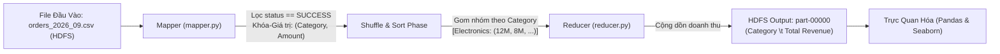

# Lab 02: Phân Tích Đơn Hàng Thương Mại Điện Tử Bằng Apache Hadoop (HDFS & MapReduce Streaming)

Tài liệu hướng dẫn và báo cáo chi tiết cho bài thực hành **Lab 02** trong học phần **Big Data (Dữ liệu lớn)**. Dự án được triển khai trên nền tảng **Google Colab** mô phỏng cụm **Apache Hadoop (Pseudo-Distributed Mode)** và sử dụng kỹ thuật **Hadoop Streaming với Python** để xử lý tập dữ liệu thương mại điện tử lớn.

---

## Mục Lục
1. [Giới Thiệu & Mục Tiêu](#giới-thiệu--mục-tiêu)
2. [Cấu Trúc Thư Mục](#cấu-trúc-thư-mục)
3. [Mô Tả Tập Dữ Liệu](#mô-tả-tập-dữ-liệu)
4. [Kiến Trúc & Quy Trình Xử Lý](#kiến-trúc--quy-trình-xử-lý)
5. [Nội Dung Chi Tiết Trong Notebook](#nội-dung-chi-tiết-trong-notebook)
   - [Phần 1: Cài đặt & Cấu hình Hadoop](#phần-1-cài-đặt--cấu-hình-hadoop-single-node)
   - [Phần 2: Quản trị Lưu trữ HDFS](#phần-2-quản-trị-lưu-trữ-hdfs)
   - [Phần 3: Phát triển Thuật toán MapReduce](#phần-3-phát-triển-thuật-toán-mapreduce)
   - [Phần 4: Trực quan hóa & Báo cáo Doanh thu](#phần-4-trực-quan-hóa--báo-cáo-doanh-thu)
   - [Phần 5: Báo cáo Lý thuyết Hệ sinh thái Hadoop](#phần-5-báo-cáo-lý-thuyết-hệ-sinh-thái-hadoop)
   - [Phần 6: Các Nhiệm vụ Mở rộng Nâng cao](#phần-6-các-nhiệm-vụ-mở-rộng-nâng-cao)
6. [Hướng Dẫn Chạy Trên Google Colab](#hướng-dẫn-chạy-trên-google-colab)
7. [Các Lỗi Thường Gặp & Cách Khắc Phục](#các-lỗi-thường-gặp--cách-khắc-phục)

---

## Giới Thiệu & Mục Tiêu

### 1. Bối cảnh bài toán
Một sàn thương mại điện tử ghi nhận hàng nghìn giao dịch trong tháng 09/2026 từ nhiều kênh phân phối (`web`, `mobile`, `partner`) trên khắp các tỉnh thành. Bộ phận vận hành và kinh doanh cần báo cáo nhanh:
- Nhóm sản phẩm (category) nào đem lại **doanh thu cao nhất** từ các đơn hàng giao dịch thành công (`SUCCESS`)?
- Phân tích rủi ro đơn hàng (`FAILED`) theo kênh và thời gian giao hàng (`shipping_days`) theo khu vực.
- Giải quyết bài toán trên nền tảng tính toán phân tán **Apache Hadoop** bằng mô hình **MapReduce**.

### 2. Mục tiêu kỹ thuật
- **Lưu trữ phân tán**: Hiểu nguyên lý và thao tác thành thạo trên hệ thống tệp phân tán **HDFS** (`NameNode`, `DataNode`, `Blocks`, `Replication`).
- **Xử lý phân tán**: Thiết kế thuật toán song song với **Mapper**, cơ chế **Shuffle & Sort**, và **Reducer** thông qua **Hadoop Streaming**.
- **Tối ưu hóa**: Thiết kế bộ nhớ đệm **In-memory Combiner** (Mini-Reducer) để giảm lưu lượng I/O qua mạng và phân tích ảnh hưởng của hiện tượng **Small File Problem**.
- **Kiểm chứng (Cross-validation)**: Đối chiếu tính toàn vẹn và độ chính xác của kết quả MapReduce so với thư viện **Pandas**.

---

## Cấu Trúc Thư Mục

```text
lab02/
├── Lab02.ipynb                                    # Jupyter Notebook chính chứa toàn bộ mã nguồn và thực nghiệm
├── orders_2026_09.csv                             # Tập dữ liệu giao dịch thương mại điện tử tháng 09/2026
├── Huong_dan_HDFS_Hadoop_tren_Google_Colab.docx  # Hướng dẫn chi tiết từng bước thao tác HDFS trên Colab
├── Huong_dan_thuc_hanh_Hadoop_tren_Google_Colab.pptx # Slide hướng dẫn thực hành Colab
├── Bai_thuc_hanh_Hadoop_online_mien_phi.pptx      # Slide bài giảng và yêu cầu sản phẩm nộp
└── README.md                                      # Tài liệu giải thích chi tiết toàn bộ dự án
```

---

## Mô Tả Tập Dữ Liệu

Tệp dữ liệu [`orders_2026_09.csv`](file:///Users/m/Documents/BIGDATA/lab02/orders_2026_09.csv) chứa thông tin chi tiết về từng đơn hàng:

| Tên Cột | Kiểu Dữ Liệu | Ví Dụ | Ý Nghĩa Nghiệp Vụ |
| :--- | :--- | :--- | :--- |
| `transaction_id` | String | `TX000001` | Mã định danh duy nhất của giao dịch |
| `order_date` | Date | `9/30/2026` | Ngày đặt hàng |
| `order_time` | Time | `2:25:00` | Giờ đặt hàng |
| `province` | String | `Ha Noi`, `Da Nang` | Tỉnh/thành phố nhận hàng |
| `category` | String | `Electronics`, `Beauty` | Danh mục / Nhóm sản phẩm |
| `channel` | String | `web`, `mobile`, `partner` | Kênh thực hiện đơn hàng |
| `quantity` | Integer | `1`, `3` | Số lượng sản phẩm |
| `unit_price` | Float | `294947` | Đơn giá sản phẩm (VNĐ) |
| `amount` | Float | `294947` | Tổng tiền thanh toán của đơn hàng (VNĐ) |
| `status` | String | `SUCCESS`, `FAILED` | Trạng thái giao dịch |
| `shipping_days` | Integer | `2`, `4` | Số ngày thực tế để hoàn thành giao hàng |

---

## Kiến Trúc & Quy Trình Xử Lý



---

## Nội Dung Chi Tiết Trong Notebook

Mọi nội dung thực hành được thiết kế mạch lạc trong tệp [`Lab02.ipynb`](file:///Users/m/Documents/BIGDATA/lab02/Lab02.ipynb):

### Phần 1: Cài Đặt & Cấu Hình Hadoop (Single-Node)
1. **Cài đặt Java JDK 8**: Cài đặt OpenJDK 8 (`openjdk-8-jdk-headless`) đảm bảo môi trường thực thi cho JVM.
2. **Cài đặt Apache Hadoop**: Tải và giải nén phiên bản ổn định `Hadoop 3.3.6` vào `/usr/local/hadoop`.
3. **Thiết lập biến môi trường**: Cấu hình `JAVA_HOME`, `HADOOP_HOME`, và cập nhật biến `PATH`.
4. **Cấu hình SSH không mật khẩu (Passwordless SSH)**:
   - Cài đặt `openssh-server`, sinh SSH key RSA không passphrase (`ssh-keygen -t rsa -P ''`).
   - Cấp quyền cho `authorized_keys` và thiết lập cấu hình daemon cho phép root login.
5. **Cấu hình hệ thống Hadoop qua file XML**:
   - `core-site.xml`: Thiết lập hệ thống tệp mặc định là `hdfs://localhost:9000`.
   - `hdfs-site.xml`: Cấu hình hệ số bản sao `dfs.replication = 1` (do chạy trên một node duy nhất).
   - `hadoop-env.sh`: Thiết lập cố định đường dẫn `JAVA_HOME` và quyền hạn người dùng root cho các tiến trình HDFS/YARN.

### Phần 2: Quản Trị Lưu Trữ HDFS
1. **Định dạng NameNode**:
   ```bash
   echo "Y" | /usr/local/hadoop/bin/hdfs namenode -format -force
   ```
2. **Khởi động các dịch vụ HDFS**: Khởi chạy NameNode, DataNode và SecondaryNameNode thông qua `start-dfs.sh`. Kiểm tra trạng thái bằng lệnh `jps`.
3. **Thao tác dữ liệu với lệnh `hdfs dfs`**:
   - Vượt qua chế độ an toàn: `hdfs dfsadmin -safemode leave`
   - Tạo thư mục người dùng: `hdfs dfs -mkdir -p /user/hadoop/input`
   - Đẩy tệp dữ liệu vào HDFS: `hdfs dfs -put -f /content/orders_2026_09.csv /user/hadoop/input/`
   - Kiểm tra danh sách tệp: `hdfs dfs -ls /user/hadoop/input/`

### Phần 3: Phát Triển Thuật Toán MapReduce
Chương trình sử dụng cơ chế **Hadoop Streaming** truyền luồng dữ liệu qua chuẩn `stdin` và `stdout`:

#### 1. Mapper (`mapper.py`)
- Sử dụng module `csv` để phân rã chính xác các dòng bản ghi.
- Bỏ qua dòng tiêu đề.
- Kiểm tra điều kiện: chỉ xử lý khi `status == 'SUCCESS'`.
- Trích xuất: Cột `category` (khóa) và `amount` (giá trị).
- Xuất dữ liệu: `print(f"{category}\t{amount}")`.

#### 2. Reducer (`reducer.py`)
- Tiếp nhận dòng dữ liệu từ stdin đã được sắp xếp theo khóa (Key-grouped).
- Duy trì biến `current_category` và `current_revenue`.
- Khi gặp khóa mới: in kết quả tổng doanh thu của danh mục cũ và khởi tạo cộng dồn cho danh mục mới.
- Đảm bảo in bản ghi của danh mục cuối cùng sau khi hết luồng dữ liệu.

### Phần 4: Trực Quan Hóa & Báo Cáo Doanh Thu
- Đọc tệp đầu ra `part-00000` / `mr_revenue_output.txt`.
- Định dạng tiền tệ theo chuẩn Việt Nam (`VNĐ`).
- Vẽ biểu đồ cột ngang trực quan bằng `seaborn.barplot` và `matplotlib`.
- Đưa ra nhận xét chiến lược: Danh mục chủ lực tạo doanh thu cao nhất, danh mục tiềm năng và đề xuất tối ưu hóa tồn kho/khuyến mại.

---

### Phần 5: Báo Cáo Lý Thuyết Hệ Sinh Thái Hadoop

Notebook tổng hợp giải thích chi tiết 4 thành phần nòng cốt:

1. **HDFS (Hadoop Distributed File System)**:
   - Hệ thống lưu trữ tệp phân tán trên cụm máy tính thông thường (commodity hardware).
   - Tệp được chia thành các khối dữ liệu (**Block** - mặc định 128MB).
   - **NameNode**: Quản lý metadata, namespace và vị trí lưu trữ của từng block.
   - **DataNode**: Lưu trữ các block vật lý và định kỳ gửi tín hiệu nhịp tim (Heartbeat) / báo cáo block (Blockreport) về NameNode.
   - Cơ chế nhân bản (**Replication Factor**) giúp hệ thống có khả năng chịu lỗi cao (Fault Tolerance).

2. **YARN (Yet Another Resource Negotiator)**:
   - Đóng vai trò là hệ điều hành phân tán quản lý tài nguyên của Hadoop.
   - **ResourceManager**: Điều phối và cấp phát tài nguyên (CPU, RAM) toàn cụm.
   - **NodeManager**: Giám sát và quản lý tài nguyên tại từng nút máy chủ cụ thể.
   - **ApplicationMaster**: Đàm phán tài nguyên với ResourceManager và phối hợp với NodeManager để thực thi một tác vụ riêng biệt.

3. **Giai đoạn Map (Mapper)**:
   - Tiếp nhận các khối dữ liệu đầu vào dưới dạng cặp `(Key, Value)`.
   - Thực hiện thao tác lọc, làm sạch và chiếu dữ liệu thành các cặp khóa-giá trị trung gian `(K2, V2)`.
   - Chạy song song độc lập trên từng máy tính chứa block dữ liệu (Data Locality).

4. **Giai đoạn Shuffle & Sort và Reduce**:
   - **Shuffle & Sort**: Hadoop tự động phân vùng (Partition), chuyển dữ liệu qua mạng và sắp xếp toàn bộ các giá trị có cùng một khóa `K2` về cùng một nút Reducer: `(K2, list(V2))`.
   - **Reducer**: Tổng hợp, gom nhóm và tính toán (Sum, Count, Avg, Min, Max) để xuất ra kết quả cuối cùng `(K3, V3)`.

---

### Phần 6: Các Nhiệm Vụ Mở Rộng Nâng Cao

Trong tệp notebook, phần mở rộng cung cấp 6 bài toán chuyên sâu sát thực tế:

#### Nhiệm vụ 1: Doanh thu theo Tỉnh/Thành (`province`)
- Thống kê doanh thu cho các đơn hàng thành công theo từng địa bàn tỉnh thành.
- Nhận diện các thị trường mũi nhọn (Hà Nội, TP.HCM, Đà Nẵng, Hải Phòng...) để ưu tiên mở kho hàng trung chuyển.

#### Nhiệm vụ 2: Tỷ lệ Thất bại (`FAILED Rate`) theo Kênh bán hàng
- Phân tích tỷ lệ giao dịch thất bại trên các kênh `web`, `mobile`, `partner`.
- Xác định kênh thanh toán nào có rủi ro cao hoặc lỗi kỹ thuật để tối ưu cổng thanh toán (Payment Gateway).

#### Nhiệm vụ 3: Thời gian giao hàng trung bình (`shipping_days`)
- Tính số ngày giao hàng trung bình theo từng tỉnh thành.
- Đánh giá hiệu suất của các đơn vị đối tác vận chuyển theo từng khoảng cách địa lý.

#### Nhiệm vụ 4: Thiết kế In-memory Combiner
- **Mục đích**: Tối ưu hóa pha **Shuffle & Sort**. Thay vì gửi hàng triệu dòng `(Category, Amount)` qua mạng Internet/Switch, Combiner đóng vai trò là một "Mini-Reducer" cộng dồn trước tại bộ nhớ RAM cục bộ của từng Mapper.
- **Kết quả mô phỏng**: Giảm kích thước bản ghi truyền qua mạng từ hàng nghìn giao dịch xuống chỉ còn số lượng bản ghi tương ứng với số danh mục duy nhất.

#### Nhiệm vụ 5: Kiểm tra chéo (Validation) MapReduce vs Pandas
- Thực hiện so sánh trực tiếp từng giá trị doanh thu của MapReduce với kết quả tính toán độc lập của Pandas (`groupby('category')['amount'].sum()`).
- Khẳng định thuật toán phân tán đạt **độ chính xác tuyệt đối 100% (chênh lệch = 0.0 VNĐ)**.

#### Nhiệm vụ 6: Mô phỏng bài toán Tập tin nhỏ (Small File Problem)
- **Vấn đề**: HDFS được thiết kế tối ưu cho một lượng nhỏ các tệp dung lượng rất lớn. Khi chia nhỏ dữ liệu thành hàng trăm, hàng nghìn tệp nhỏ (ví dụ chia thành 100 file con):
  1. **Quá tải bộ nhớ NameNode**: Mỗi tệp dù chỉ vài KB vẫn chiếm khoảng 150 byte metadata trong RAM NameNode.
  2. **Lãng phí tài nguyên CPU/JVM**: Mỗi tệp nhỏ kích hoạt một tác vụ Mapper riêng biệt, chi phí khởi tạo và dọn dẹp JVM lớn hơn rất nhiều so với thời gian xử lý thực tế.

---

## Hướng Dẫn Chạy Trên Google Colab

1. **Khởi tạo môi trường**:
   - Truy cập [Google Colab](https://colab.research.google.com).
   - Mở tệp [`Lab02.ipynb`](file:///Users/m/Documents/BIGDATA/lab02/Lab02.ipynb).
   - Chọn menu `Runtime` -> `Change runtime type` -> Chọn `CPU` (hoặc T4 GPU nếu muốn).
2. **Tải dữ liệu lên Colab**:
   - Tải tệp [`orders_2026_09.csv`](file:///Users/m/Documents/BIGDATA/lab02/orders_2026_09.csv) lên thư mục `/content/` trên thanh công cụ quản lý tệp bên trái của Google Colab.
3. **Thực thi tuần tự**:
   - Chạy tuần tự từng ô lệnh từ ô số `1` đến ô số `34`.
   - Không bỏ qua bước cài đặt Java, SSH và định dạng NameNode.
4. **Lưu trữ kết quả**:
   - Do Google Colab sẽ xóa toàn bộ môi trường tạm thời khi tắt trình duyệt, sau khi hoàn thành hãy tải notebook và các tệp kết quả (`mr_revenue_output.txt`, các biểu đồ) về máy tính cá nhân.

---

## Các Lỗi Thường Gặp & Cách Khắc Phục

| Lỗi gặp phải | Nguyên nhân | Cách khắc phục |
| :--- | :--- | :--- |
| `Cannot create directory ... Name node is in safe mode` | HDFS đang tự kiểm tra an toàn sau khi khởi động | Chạy lệnh: `!hdfs dfsadmin -safemode leave` để mở khóa chế độ ghi |
| `ssh: connect to host localhost port 22: Connection refused` | Dịch vụ SSH chưa khởi chạy hoặc bị crash | Khởi động lại service: `!service ssh restart` và kiểm tra lại `ssh-keygen -A` |
| `DataNode is not running (chỉ thấy NameNode trong jps)` | ID Cluster bị lệch do format lại NameNode nhiều lần | Xóa sạch thư mục data cũ: `!rm -rf /tmp/hadoop-root/dfs/data/*` trước khi format và restart HDFS |
| `No such file or directory: '/content/orders_2026_09.csv'` | Tệp dữ liệu chưa được tải lên máy ảo Colab | Tải lại tệp dữ liệu vào thư mục gốc `/content/` của phiên Colab |
